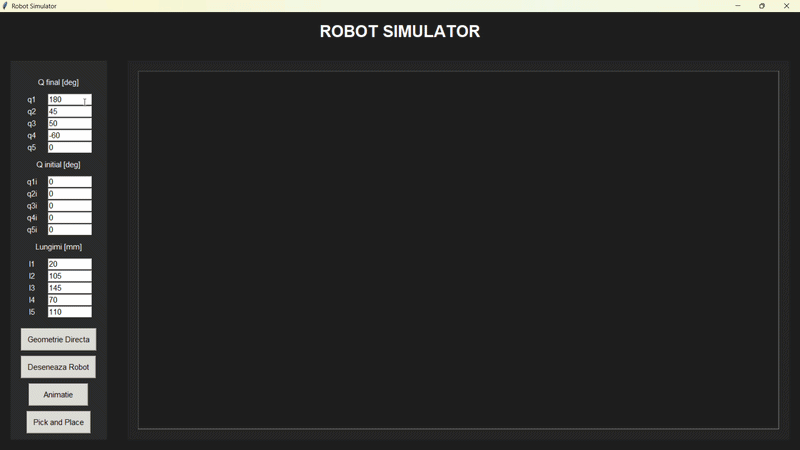

# Python Application for 3-Axis Robot Configuration and Kinematic Simulation

## Overview

This project develops an object-oriented modular application in Python designed to model kinematic movements, generate geometric configurations, and simulate the operation of a 3-axis robot in a three-dimensional space. The application integrates homogeneous matrix calculations, 3D graphical rendering, and an interactive graphical user interface (GUI).

  

## Features

- Object-Oriented Modular Architecture: Implemented using abstract classes, inheritance, and composition across Classes.py, Robot.py, and main.py files.
- Matrix Kinematic Modeling: Utilizes 4x4 homogeneous transformation matrices and dedicated classes for rotational joints (along X, Y, Z axes) and translational joints.
- 3D Simulation & Animation: Capable of computing direct kinematics, rendering the robot's configuration, and generating Pick and Place trajectories with smooth animations.
- Graphical User Interface (GUI): Developed with Tkinter and ttk, allowing users to input kinematic parameters (angles, lengths, positions), validate data, and view real-time updates.

## Technologies Used

- Language: Python.
- Libraries: NumPy (for matrix operations and 3D geometric transformations), Matplotlib (for 3D rendering and animation), Tkinter/ttk (for the graphical interface), ABC (for abstract classes).

## Architecture

The application structure is divided into three primary modules:

- Classes.py: Defines the abstract class Cupla with the transformare() method, extended through Rotatie (X, Y, Z) and Translatie (X, Y, Z) classes, which are subsequently combined into the Joint class.
- Robot.py: Manages a list of joints (Joints), calculating the origin, direct kinematics (Geom_Directa), 3D rendering, intermediate matrix animations, and PickandPlace() trajectories.
- main.py: Provides the graphical interface for the user, integrating data validation via try / except blocks and error message handling.

## Results

- Achieved a stable application capable of simulating the movements of a 3-axis robot in real-time based on user-defined parameters.
- Implemented a robust error-handling system to prevent application crashes when encountering invalid numerical values.

## Documentation

[Presentation](Prezentare-Aplicatie.pptx)

[Documentation](Aplicatie%20de%20calcul%20pentru%20configurarea%20unui%20robot%20(1).pdf)

[Video](videoP.mp4)
