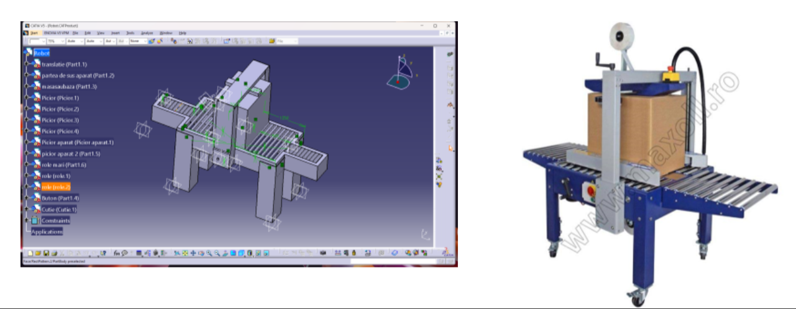

# Virtual Reality (VR) Interactive Simulation: Box Sealing Robot

## Overview

This project develops an interactive 3D/VR simulation of an industrial box-sealing machine. The system bridges mechanical CAD modeling with real-time game engine environments, allowing users to interactively control translation movements and reset simulation scenes. Following its academic development, this box-sealing robot project was subsequently selected and utilized as a hands-on project at the Siemens Summer School.

Furthermore, an Augmented Reality (AR) Instagram effect was developed for the project, allowing users to scan a specific poster with their smartphone camera and view an interactive 3D digital model of the box-sealing robot in the real-world environment.

  

## Features & Results

- 3D CAD Modeling: Designed the complete mechanical assembly of the box-sealing robot (including base, pillars, conveyor rollers, sealing apparatus, and boxes) using CATIA V5.
- Mesh Processing & Asset Import: Processed and converted CAD data using Meshlab for optimization before importing into the Unity engine.
- Interactive Controls & Scripting: Implemented C# scripts in Unity to control operational components: A / D keys: Left and right translation of the box, Q / E keys: Left and right translation of the sealing apparatus, R key: Scene reset.
- Virtual Environment: Assembled a complete industrial simulation scene with custom lighting, walls, and functional conveyor mechanics.
- 

  

## Technologies Used

- CAD Software: CATIA V5.
- Mesh Processing: Meshlab.
- Game Engine & Simulation: Unity (C# scripting).

## Documentation

[Presentation](Prezentare%20proiect%20RV.pptx)

[Siemens](ESSS/Utilaj%20de%20lipit%20cutii_FINAL.pptx)
