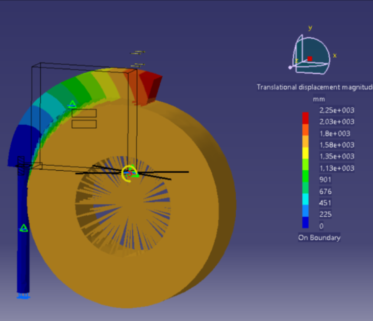
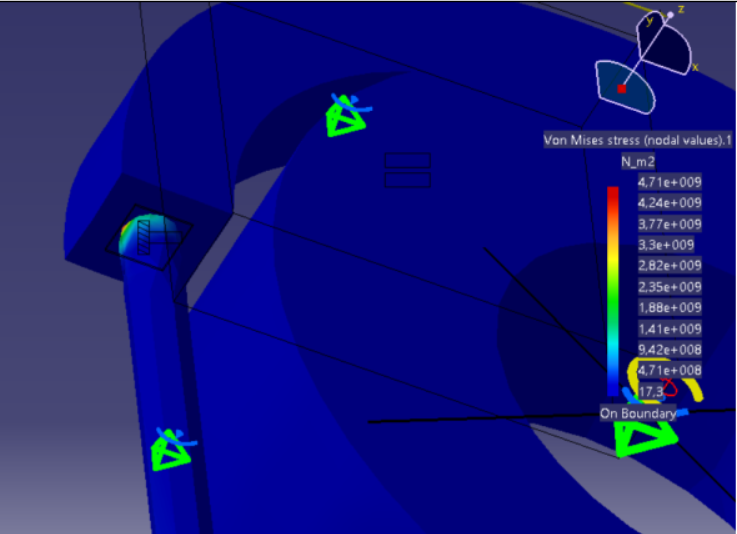

# Finite Element Analysis

## Overview

A structural and finite element analysis (FEM) report evaluating mechanical components under static and complex loading conditions.

  

## Features & Results

- FEM Simulation: Performed mesh generation, applied boundary conditions, and analyzed stress/strain distributions across critical parts.
- Structural Verification: Identified peak von Mises stress zones and ensured compliance with material safety limits.

  

## Technologies Used

-CAE / FEM software, CAD modeling tools: CATIA

## Documentation

[Documentation](Proiect%20FEM-Condrea%20Laurentiu%20Daniel.doc)
