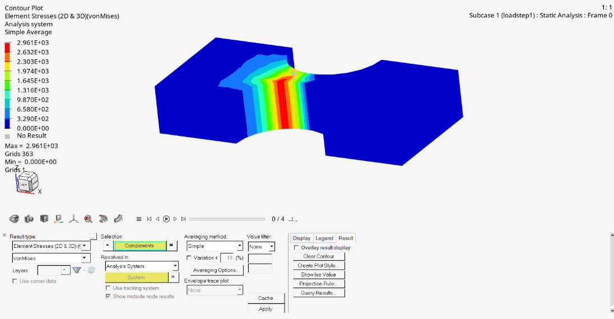
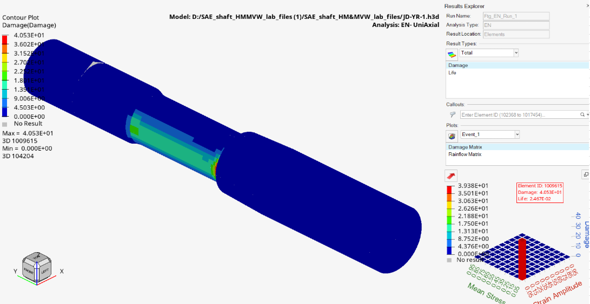
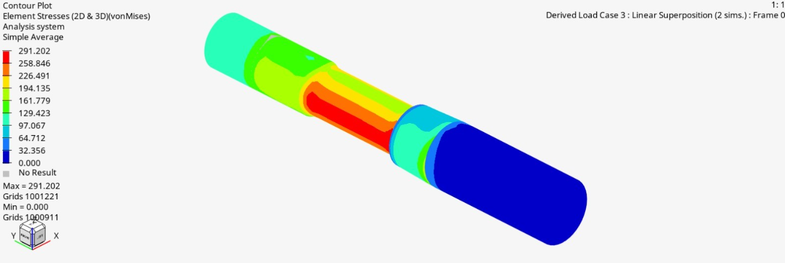

# Fatigue Evaluation

## Overview 

A structural and finite element analysis (FEA) report evaluating mechanical components under static loads and fatigue cycles.

  

## Features & Results 

- Static Analysis: Evaluated von Mises stresses against the material's yield limit (200 MPa) and calculated Reserve Factors (RF) for complex bending and torsional moments.
- Fatigue Evaluation: Performed durability simulations using the Ramberg-Osgood model, Smith-Watson-Topper criterion, and Rainflow cycle-counting techniques.
- Validation: Successfully identified critical stress zones and generated fatigue distribution profiles under dynamic operational loads.

  

  

## Documentation

[Dataset](Sarcini%20de%20lucru-%20Condrea%20Laurentiu%20.xlsx)
