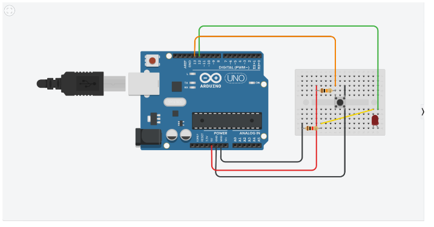
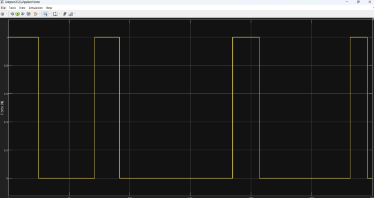

# Hybrid Engineering: Controlling a Mechanism via Arduino and MATLAB Simulink

## Overview

This project develops a hardware-software hybrid interface that connects an Arduino microcontroller with the MATLAB Simulink physical simulation environment. Via a physical button connected to the Arduino, the user can directly trigger the generation of a pre-calculated trajectory (position, velocity, acceleration) and the activation of a 3D physical model in Simulink, observing real-time interaction between physical input and virtual simulation.

  

## Features

- Hardware-Software Integration: Connects an Arduino UNO development board directly with Simulink blocks via serial communication.
- Polynomial Trajectory Calculation: Uses a MATLAB script to internally generate equations for a "Pick and Place" motion profile using 3rd-order polynomial interpolation, producing matrices for position (qt), velocity (viteza), and acceleration (acceleratie).
- Conditional Command: The physical button signal activates a conditioned subsystem ("Enable block") in Simulink to trigger motion; the mechanism maintains its final position upon button release using the "Clip" function.
- 3D Physical Simulation: Utilizes File Solid blocks (imported from CAD software), Rigid Transform, and Revolute Joint blocks to build and animate the physical motion of the mechanism in a 3D space.

## Technologies Used

- Hardware: Arduino UNO, push-button, internal pull-up resistors, LED.
- Software (Computation): MATLAB (for the PickandPlace function and matrix calculations).
- Software (Simulation): MATLAB Simulink, Simscape blocks, Serial Configuration.

## Architecture

- Hardware Side (Arduino): The Arduino board is programmed to read the button state (PIN 2) using the internal pull-up resistor. If pressed (LOW), it turns on an LED (PIN 3) and transmits numeric data packets via Serial.write(buttonState) at a baud rate of 115200.
- Switching Side (Simulink): The Serial Receive block captures the inverted logic from Arduino (pressed = 0, released = 1). A NOT logic block corrects the signal to transmit $1$ exclusively upon pressing.
- Signal Generator: Upon receiving a signal of $1$, a subsystem ("Enable block") is activated. Within it, a constant is integrated to generate "time," which feeds three "1-D Lookup Table" blocks. These tables utilize data previously generated by the MATLAB script to simultaneously output position, velocity, and acceleration signals.
- Physical Integration (Simscape): A Simulink-PS Converter transforms these mathematical signals into physical mechanical signals. These dictate the "q" angles at the Revolute Joint blocks (mechanism joints), driving the visual animation of pre-loaded parts (File Solid).

## Results

- Graphs were generated proving the successful execution of the trajectory over a $T = 4$ second interval, accurately depicting an S-curve for position, a parabola for velocity, and a linear downward slope for acceleration.
- Execution over a 300-second duration with repeated button presses (3 times) confirms that the pause/clip logic and signal inversion functioned perfectly, generating motion exclusively upon user input.

  

## Documentation

[Documentation](Inginerie%20hibrida.pdf)
