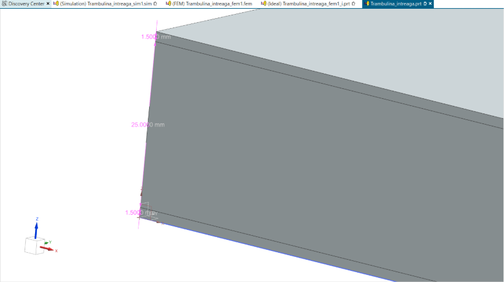
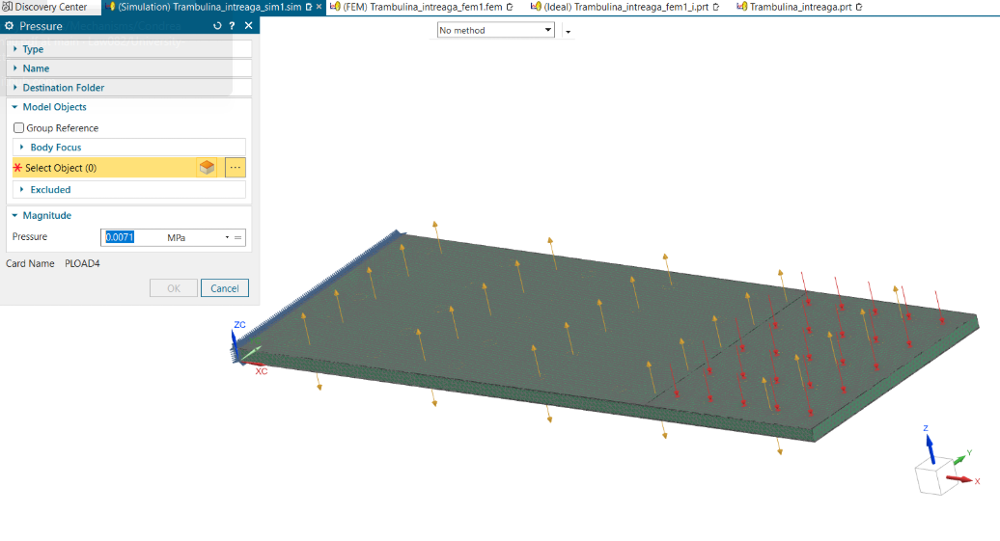
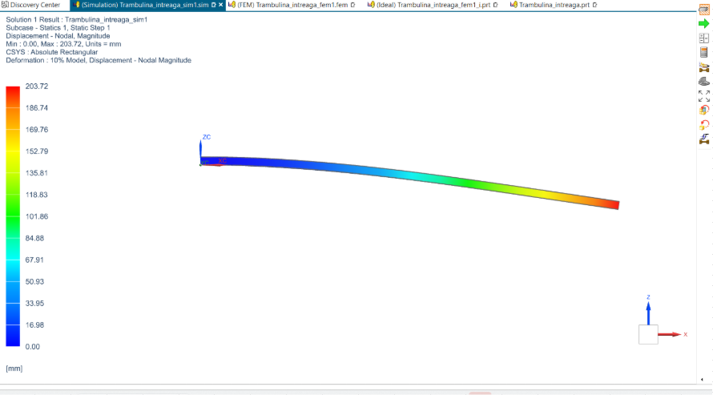

# Design and Simulation: Composite Diving Board / Trampoline

## Overview

This technical project documents the analytical calculation and structural simulation of a sandwich-type composite diving board. The structure features an H60 foam core and GFRP (Glass Fiber Reinforced Polymer) outer skins. The main goal is to optimize mass and cost while strictly adhering to rigidity and deformation limits under load.

  

## Features

- Sandwich Design: The diving board measures 1410 mm in length, 500 mm in width, and has a total thickness of 28 mm (25 mm H60 core, and 1.5 mm GFRP skin on each side).
- Structural Analysis (FEA vs. Analytical): A load of 1471.5 N is applied. The analytically calculated displacement is 239.85 mm, compared to 203.72 mm obtained via simulation. Both remain well below the maximum allowable displacement of 294.3 mm.
- Stiffness Verification: The calculated stiffness ($K = 6.13$ N/mm) successfully meets the project constraint, exceeding the 5 N/mm minimum threshold.
- Cost and Mass Optimization: The final structure is exceptionally lightweight and economical, with a total mass of 4.44 kg and an estimated material cost of 19.88 units.

## Technologies Used

- FEA Software Simcenter3D: Structural simulation utilizing a 10 mm tetrahedral mesh to analyze deformations and stresses across the core and skins.
- Data Analysis: Microsoft Excel for centralizing material parameters, evaluating costs, and calculating stresses and safety factors.

  

## Architecture

The methodology began by defining the geometric and material properties: a modulus of elasticity ($E_f$) of 20,000 MPa for the GFRP skins, and specific foam parameters (e.g., $G_c = 22$ MPa) for the H60 core. Rigorous analytical calculations were performed to determine stiffness and theoretical maximum displacement ($W$). An FEA simulation was then executed. Finally, the values were compared to ensure they met the required safety factor of 5, with allowable stresses capped at 80 MPa for the skin and 0.12 MPa for the core.

## Results

- Simulation Error: The absolute difference between the theoretical calculation and the simulation resulted in a deformation error of approximately 36.13 mm.
- The structural parameters (203.72 mm simulated displacement and 6.13 N/mm stiffness) fully comply with the design specifications and safety limits.
- The project successfully demonstrated the viability of using composite materials for structures subjected to recurrent bending forces, achieving an excellent balance between low mass (4.44 kg) and high structural integrity.

  

## Documentation 

[Dataset](Trambulina_corecta_Condrea_Laurentiu.xlsx)
