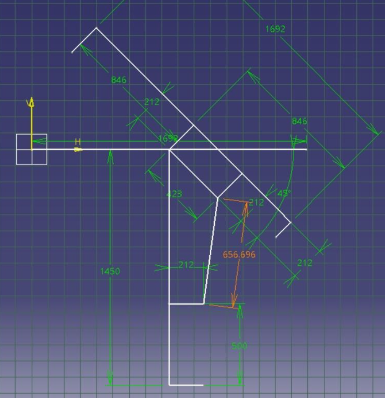
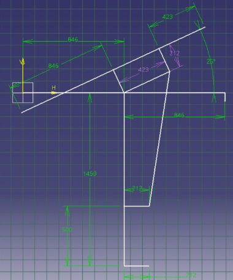
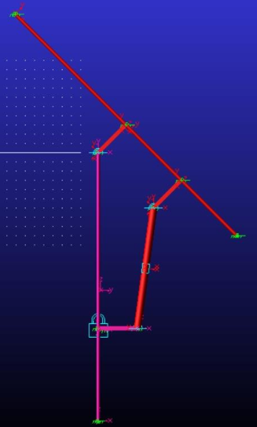

# Mechatronic Systems (Photovoltaic Module System)

## Overview

This project presents the design of a mechatronic system for orienting a photovoltaic panel, developed under the coordination of Prof. Crețescu Nadia Ramona. The main goal is to create an orientation mechanism (solar tracker) that allows the panel to tilt between a minimum angle of $-45^\circ$ and a maximum angle of $+25^\circ$.

  

  

## Features

- The photovoltaic panel has dimensions of 1692 x 1134 x 30 mm and a weight of 21.2 kg.
- The attachment point distance on the panel is set to 423 mm (OB distance).
- The main electrical parameters of the panel include a maximum power of 400 W, an efficiency of 20.8%, and an optimal operating voltage of 31 V.
- The required stroke for the actuator was calculated by the difference between the maximum length ($1141.702$ mm) and the minimum length ($656.696$ mm) of the mechanism, resulting in a value of $485.006$ mm
- The system uses a standard linear actuator with a 500 mm stroke, which fully covers the theoretical movement requirement.
- Kinetostatics and kinematics are modeled through translational and rotational joints between the pillar, connecting elements, and actuator cylinders.

## Technologies Used

- CAD Software: CATIA was used to design and represent the system in its extreme positions (horizontal, maximum, and minimum) to extract the geometric limits.
- CAE/Simulation Software: MSC ADAMS was used for 2D kinematic modeling, defining the rigid elements (pillar, module, actuator), joints, and time-dependent laws of motion.

## Architecture

The design methodology began with establishing the geometry in CATIA to determine the required extension of the actuation mechanism at the desired inclinations. Subsequently, the model was transferred to the ADAMS environment by defining 9 specific coordinate points (from A to I) that make up the mechanism's skeleton. Based on these points, the structural elements were defined using primitive geometric shapes, such as cylinders for the pillar and panel, and "link" type elements for the rods. Kinematic links were established by defining five joints: an internal translational joint for the two actuator segments, a fixed joint (lock/ground) for the pillar base, and three rotational joints at the rod intersections. The system's displacement was generated by applying a time-dependent function (485.006/8 * time) directly to the actuator's translational joint.

## Results 

- The geometric calculations performed in the CAD design phase allowed for the precise determination of the required dimensional variation, confirming that an actuator with an extended length of 1050 mm and a stroke of 500 mm is suitable for the system.
- The model created in ADAMS successfully validated the kinematic operation of the entire mechanism under the imposed law of motion.
- The graph generated from the ADAMS simulation demonstrates the achievement of the desired movement, covering a total and linear variation of the $\beta$ angle of $70^\circ$ (from $-45^\circ$ to $+25^\circ$) over 8 seconds of simulation.

  

## Documentation

[Presentation](Condrea%20Laurentiu%20SM.pdf)
