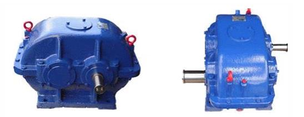
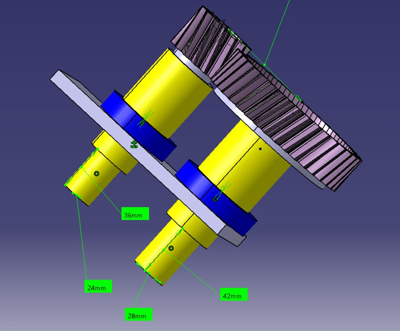
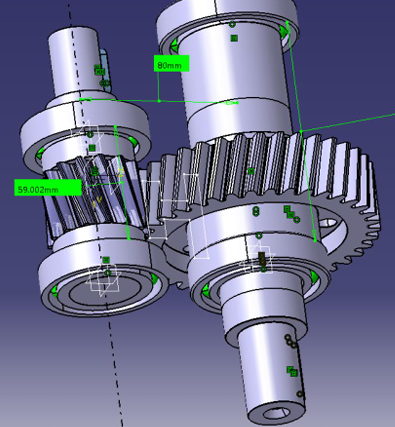
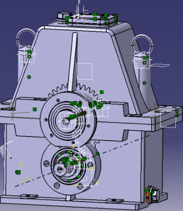

# Cylindrical Gear Reducer

## Overview

This technical project presents the complete stages of calculation, design, verification, and 3D modeling for a bevel-cylindrical gear reducer, intended for use in lifting and transport equipment, such as car lifts or brake testing stands. The goal of the work is to convert the required input data (14 kW power, 2500 rpm, 8000 hours of operation) into a functional and safe mechanical product.

  

## Features

- Calculation and sizing of cylindrical gears, establishing a standardized normal module of 3 mm and an optimized transmission ratio of 2.714.
- Shaft sizing based on combined loads (bending and torsion) and safety factors.
- Selection and durability validation of radial-axial bearings to support dynamic loads.
- Complete 3D modeling of components (shafts, gears, housings) and virtual assembly of the mechanism.
- Automatic generation of execution and assembly drawings.

## Technologies Used

- Modeling Software: CATIA (for generating 3D models of parts, subassemblies, kinematic simulation of the gearing, and generating 2D execution drawings).
- Analysis Software: MDESIGN (for analytical calculation, checking shafts for fatigue, flexural deformations, and vibrations).
- Materials: 18MnCr11 steel (case-hardened) for the gears and input shaft, and C45 steel (quenched and tempered) for the output shaft.

  

## Architecture

The project followed a mechanical synthesis methodology: it started with the structural scheme and the determination of kinetostatic parameters (speeds, torsional moments, powers for each shaft). This was followed by the pre-dimensioning of the cylindrical gear and the determination of reactions, followed by the pre-dimensioning of the shafts. The elements were then modeled in CATIA to obtain exact distances, which were inputted into the MDESIGN environment for the final verification of fatigue resistance and shaft deformations under combined loads.

  

## Results 

- The calculated yielding safety factor for the input shaft was $S_F = 1.955$, exceeding the minimum required threshold of 1.2, indicating a reliable structure.
- The deviation of the obtained transmission ratio compared to the required one was only +1.4%, falling within the acceptable tolerance.
- Following the durability calculations, the critical bearing (7207-B-JP) recorded a theoretical lifespan of 10,560 hours, successfully satisfying the initial requirement of 8,000 hours.
- The final 3D model allowed the generation of precise execution drawings for the main components (e.g., the cylindrical pinion crown).

  

## Documentation

Full details regarding the calculation formulas, loading schemes, moment diagrams, and technical drawings are available in the document:

[Documentation](Memoriu-Tehnic-proiect-OM-Laurentiu-Condrea-FINAL.pdf)
