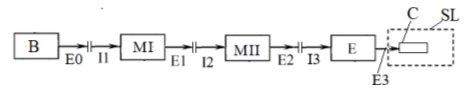
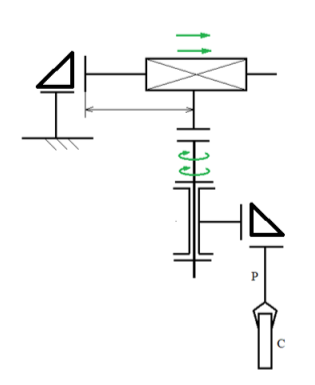
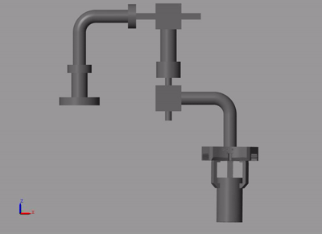
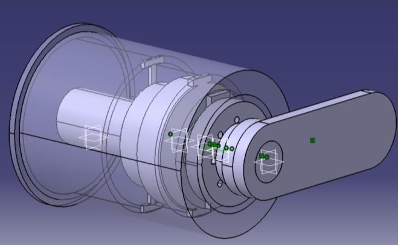
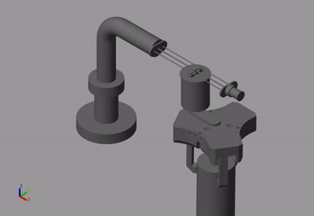

# Robot Design - Modular Mechatronic System (Translation - Rotation)

## Overview

This project details the synthesis, calculation, and 3D modeling of a modular mechatronic system (robot) consisting of two power generation modules (Translation followed by Rotation, T-R configuration). The main goal is to achieve controlled and precise movement of an effector equipped with a gripper, which handles a cylindrical steel payload (approx. 43.46 kg), intended for handling, inspection, or technological operations.

  

  

## Features

- Modular system configured for successive Translation (240 mm stroke) and Rotation (260° stroke) movements.
- Sizing and integration of a three-finger pneumatic gripper (Schunk PZH-PLUS 50) capable of rigidly supporting the workload.
- Module I (Rotation) is integrated with a 50W AC servomotor (ATO), a harmonic gearhead (Nexen), and a robust crossed roller bearing (Schaeffler).
- Module II (Translation) is directly driven by a Maxon motor connected to a ball screw (Korta 5x3) and guided by linear bushings (LM4UU); calculations demonstrated that an additional reducer is not required for this module.
- The system is designed for high positioning accuracy ($\pm 0.05$ mm) and an operating life of 10,000 hours, capable of functioning in environments with temperatures between -30 and 90°C.

## Technologies Used

- Modeling Software: CATIA (for generating the raw ver. 0 geometric model, final component assembly, kinematic simulation, and execution drawings).
- Dynamic Analysis Software: MATLAB and SimMechanics (for dynamic simulation based on "Sine Wave" blocks, determining reaction forces and moments, and generating load charts).
- Industrial Mechatronic Components: Maxon and ATO servomotors, Nexen harmonic gearheads, Schunk grippers, Schaeffler angular contact/crossed roller bearings, Korta ball screws.

  

## Architecture

The methodology relies on an iterative design algorithm: it starts by defining the robot's block diagram (Base $\rightarrow$ Module I $\rightarrow$ Module II $\rightarrow$ Effector). A simplified initial geometric version is created in CATIA (ver. 0) and then exported into the SimMechanics environment. Here, movements are simulated using sine wave signals to extract the maximum reaction forces and moments from the joints. Based on these dynamic parameters, suitable electromechanical components are sized, verified, and selected from catalogs, with the 3D model being constantly updated until the final assembled version is achieved.

  

## Results 

- The mass and inertia of the payload were accurately determined in the initial phase (steel cylinder, volume 0.006 m³, mass 43.46 kg).
- The dynamic analysis in MATLAB/SimMechanics successfully generated force and moment graphs, identifying maximum joint loads (e.g., a reaction force on the Z-axis of $N_z = 624.65$ N and a moment on the Y-axis of $M_y = 208.27$ Nm).
- Based on the extracted parameters, the selection of a 3000 rpm motor with a $i=100$ gear ratio for the rotation module was validated.
- For the translation module, a required speed of 3200 rpm was calculated for a screw with a pitch of 3, validating the use of a low-torque motor (approx. 9 mNm) without the need for a reducer.

  

## Tutorial

As part of this project, I also created a comprehensive step-by-step tutorial. This guide documents the entire workflow, from the initial geometric modeling in CATIA to the dynamic simulation in SimMechanics and the final component selection. It is designed to help other students or engineers replicate the design process, understand the kinematic and dynamic principles involved, and learn how to extract and interpret forces and moments to properly size robotic components.

## Documentation 

[Documentation](proiectarea%20robotilor/proiectarea%20robotilor/Ghid_Memoriu%20tehnic%20PrRo%20Condrea%20Laurentiu.docx)
