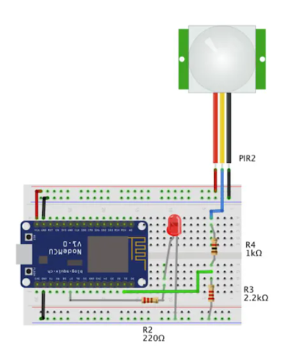
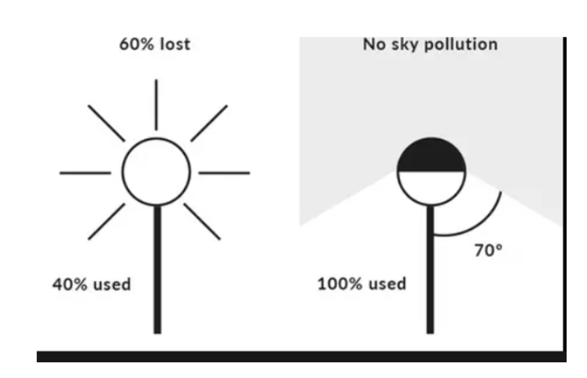

# Public Lighting Monitoring System

## Overview

This project presents an energy-efficient public lighting monitoring and control system designed to reduce light pollution and energy consumption. Using motion sensors, the system ensures that streetlights are fully illuminated only when necessary, while a local server monitors the entire process. The main objective is to combat light pollution, which disrupts wildlife, contributes to CO2 emissions, affects human sleep, and obscures the night sky.

  

## Features

- Automated light control using motion detection (PIR sensors).
- Adjustable light intensity: switches to maximum brightness (PWM 255) when motion is detected, and drops to a default low-intensity state (PWM 50) when idle.
- Real-time system monitoring via a local web server (ESP8266WebServer) displaying the status of each sensor.
- Low power consumption design tailored for battery operation.
- Designed to minimize "sky pollution" by focusing light downward (100% used) rather than radiating it upwards (60% lost).

  

## Technologies Used

- Hardware: NodeMCU ESP8266 (chosen for low power consumption).
- Hardware: PIR Motion Sensors (x3).
- Hardware: LEDs (x3) representing streetlights.
- Hardware: Resistors (220Ω, 1kΩ, 2.2kΩ).
- Hardware: 550mAh Battery.
- Software: Arduino IDE (C++).
- Software: ESP8266WiFi and ESP8266WebServer libraries.

## Architecture 

The system relies on a NodeMCU ESP8266 microcontroller connected to a local Wi-Fi network. Three PIR sensors monitor distinct zones. The ESP continuously reads the digital states of these sensors in its main loop. If a sensor detects motion (val == HIGH), the ESP uses analogWrite() to send a maximum PWM signal (255) to the corresponding LED. Otherwise, the LED remains at a defaultIntensity of 50. Simultaneously, the ESP hosts a web server on port 80, generating an HTML page that updates and displays the current state ("Detectează mișcare" / "Nu detectează mișcare") of each sensor.

## Results

- Power Consumption Analysis: The total system draws approximately 125.8 mA (ESP board: 70.5 mA, 3x Sensors: 0.3 mA total, 3x LEDs: ~54 mA total).
- Battery Life: Operating on a 550mAh battery, the estimated continuous runtime is approximately 4.37 hours (550 / 125.8).
- Proposed Improvements: Upgrading to a comprehensive control system, creating a continuous charging loop for the battery, and adding a mini solar panel for sustainable power.

## Documentation

[Presentation](Presentation%2014.pptx)
